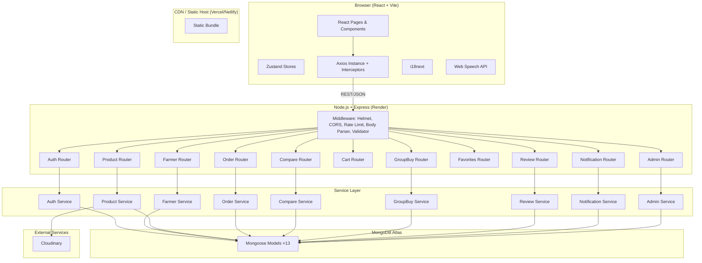
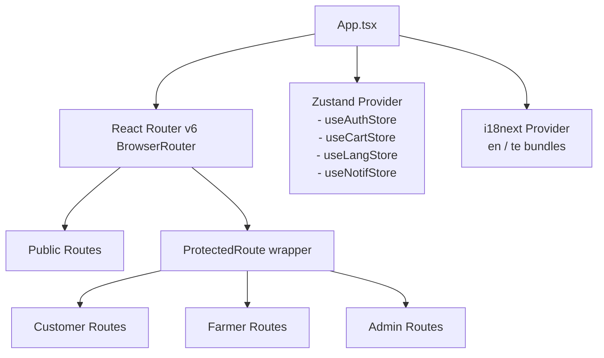
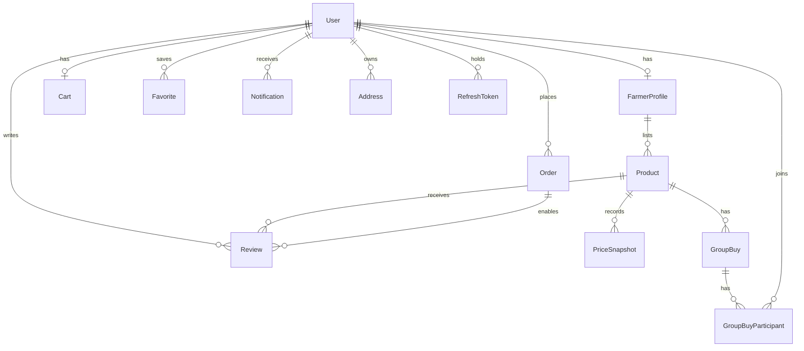

# Design Document: FarmConnect Marketplace

## Overview

FarmConnect is a full-stack MERN marketplace that eliminates intermediaries between local farmers and customers. The system is designed for a hackathon and must be immediately deployable to production. It supports two languages (English and Telugu), provides a voice-guided Easy Mode for low-literacy farmers, enables cross-farmer price comparison with delivery-cost normalization, and offers community group buying.

### Design Goals

- **Correctness over convenience**: All financial totals are calculated server-side. The browser never supplies prices.
- **Trust-but-verify**: Every authenticated request carries a short-lived JWT; session continuity is handled through HTTP-only refresh token cookies.
- **Graceful degradation**: Voice features (Web Speech API) fall back to text when unavailable. Translations fall back to English when Telugu keys are missing.
- **Mobile-first**: All layouts are designed for 320 px viewports upward.
- **Role enforcement at every layer**: RBAC guards exist on the API middleware layer, not only in the UI.

---

## Architecture

### High-Level System Architecture



### Frontend Architecture

The frontend is a single-page application built with React 18 + Vite + TypeScript. Routes are code-split at the page level using `React.lazy` + `Suspense`.



**State Management (Zustand stores):**

| Store | State |
|---|---|
| `useAuthStore` | `user`, `accessToken`, `isAuthenticated`, `login()`, `logout()`, `setToken()` |
| `useCartStore` | `cartCount`, `syncCart()` |
| `useLangStore` | `language`, `setLanguage()` |
| `useNotifStore` | `unreadCount`, `notifications[]`, `markRead()` |

**Axios Configuration:**
- A single Axios instance is created with `baseURL` pointing to the API.
- A request interceptor attaches the in-memory JWT access token as `Authorization: Bearer <token>`.
- A response interceptor catches HTTP 401, attempts `POST /api/auth/refresh` once, retries the original request with the new token, and on refresh failure clears the auth store and navigates to `/login`.

### Backend Architecture

The backend is a Node.js + Express application written in TypeScript with `"strict": true`. It follows a feature-module layout:

```
src/
  app.ts               # Express app setup, middleware registration
  server.ts            # Entry point, DB connection, process.exit on failure
  config/
    db.ts              # Mongoose connect with 10-second timeout
    env.ts             # Validates required env vars at startup
  middleware/
    auth.ts            # JWT verification, role guards
    errorHandler.ts    # Global error handler, consistent JSON shape
    rateLimiter.ts     # express-rate-limit config
    validate.ts        # Zod schema validation wrapper
  modules/
    auth/
      auth.router.ts
      auth.controller.ts
      auth.service.ts
    farmers/
      farmers.router.ts
      farmers.controller.ts
      farmers.service.ts
    products/
      products.router.ts
      products.controller.ts
      products.service.ts
    orders/
      orders.router.ts
      orders.controller.ts
      orders.service.ts
    compare/
      compare.router.ts
      compare.controller.ts
      compare.service.ts
    cart/
      cart.router.ts
      cart.controller.ts
      cart.service.ts
    groupbuy/
      groupbuy.router.ts
      groupbuy.controller.ts
      groupbuy.service.ts
    reviews/
      reviews.router.ts
      reviews.controller.ts
      reviews.service.ts
    notifications/
      notifications.router.ts
      notifications.controller.ts
      notifications.service.ts
    admin/
      admin.router.ts
      admin.controller.ts
      admin.service.ts
  models/              # All 13 Mongoose models
  utils/
    cloudinary.ts      # Upload helper
    jwt.ts             # Sign/verify helpers
    pagination.ts      # Shared pagination utility
```

**Middleware stack (applied globally):**
1. `helmet()` — secure HTTP headers
2. `cors({ origin: process.env.FRONTEND_URL })` — origin whitelist
3. `express.json({ limit: '10mb' })` — body parser with 10 MB cap
4. `rateLimiter` — 10 login attempts / 15 min per IP (applied only to `/api/auth/login`)
5. `validate(schema)` — per-route Zod validation middleware

---

## Components and Interfaces

### Frontend Route Map (34 routes)

| Route | Component | Access |
|---|---|---|
| `/` | `HomePage` | Public |
| `/login` | `LoginPage` | Public |
| `/register` | `RegisterPage` | Public |
| `/products` | `ProductListPage` | Public |
| `/products/:id` | `ProductDetailPage` | Public |
| `/farmers/:id` | `FarmerProfilePage` | Public |
| `/compare` | `ComparePage` | Public |
| `/group-buys` | `GroupBuyListPage` | Public |
| `/cart` | `CartPage` | Customer |
| `/checkout` | `CheckoutPage` | Customer |
| `/orders` | `OrderListPage` | Customer |
| `/orders/:id` | `OrderDetailPage` | Customer |
| `/favorites` | `FavoritesPage` | Customer |
| `/notifications` | `NotificationsPage` | Customer/Farmer |
| `/profile` | `CustomerProfilePage` | Customer |
| `/farmer/dashboard` | `FarmerDashboardPage` | Farmer |
| `/farmer/products` | `FarmerProductListPage` | Farmer |
| `/farmer/products/new` | `FarmerProductFormPage` | Farmer |
| `/farmer/products/new/easy` | `EasyModeProductFormPage` | Farmer |
| `/farmer/products/:id/edit` | `FarmerProductFormPage` | Farmer |
| `/farmer/orders` | `FarmerOrderListPage` | Farmer |
| `/farmer/orders/:id` | `FarmerOrderDetailPage` | Farmer |
| `/farmer/profile` | `FarmerProfileEditPage` | Farmer |
| `/farmer/group-buys` | `FarmerGroupBuyPage` | Farmer |
| `/admin/dashboard` | `AdminDashboardPage` | Admin |
| `/admin/users` | `AdminUserListPage` | Admin |
| `/admin/users/:id` | `AdminUserDetailPage` | Admin |
| `/admin/farmers` | `AdminFarmerListPage` | Admin |
| `/admin/farmers/:id` | `AdminFarmerDetailPage` | Admin |
| `/admin/products` | `AdminProductListPage` | Admin |
| `/admin/products/:id` | `AdminProductDetailPage` | Admin |
| `/admin/orders` | `AdminOrderListPage` | Admin |
| `/admin/reviews` | `AdminReviewListPage` | Admin |
| `/admin/reports` | `AdminReportsPage` | Admin |

### Shared Components

```
components/
  layout/
    Navbar.tsx          # Language switcher, notification badge, cart count, role nav
    Footer.tsx
  common/
    ProductCard.tsx     # Image, name, price, farmer name, rating badge
    FarmerCard.tsx      # Farm name, location, verification badge
    LoadingSpinner.tsx
    EmptyState.tsx      # Illustration + message + optional CTA
    ErrorBoundary.tsx
    Modal.tsx           # Accessible dialog with focus trap
    Toast.tsx           # Ephemeral success/error/info banners
    LanguageSwitcher.tsx
    Pagination.tsx
  auth/
    ProtectedRoute.tsx  # Checks isAuthenticated; redirects to /login
    RoleGuard.tsx       # Checks role; renders 403 page on mismatch
  easy-mode/
    EasyModeToggle.tsx
    VoiceInputField.tsx
    VoiceConfirmDialog.tsx
    StepIndicator.tsx
```

### Key Component Interfaces (TypeScript)

```typescript
// ProductCard props
interface ProductCardProps {
  product: ProductSummary;
  showFarmerName?: boolean;
  showBestValueBadge?: boolean;
}

// ProtectedRoute props
interface ProtectedRouteProps {
  children: React.ReactNode;
  requiredRole?: 'customer' | 'farmer' | 'admin';
}

// VoiceInputField props
interface VoiceInputFieldProps {
  fieldName: string;
  label: string;
  value: string;
  onChange: (value: string) => void;
  language: 'en' | 'te';
  speechApiAvailable: boolean;
}
```

### API Response Shape

All API responses follow a consistent envelope:

```typescript
// Success
{ "success": true, "data": T, "meta"?: PaginationMeta }

// Error
{ "success": false, "message": string, "errors"?: Record<string, string[]> }

// Pagination meta
interface PaginationMeta {
  page: number;
  pageSize: number;
  totalPages: number;
  totalCount: number;
}
```

---

## Data Models

### 1. User

```typescript
interface IUser {
  _id: ObjectId;
  name: string;                    // 1–100 chars
  email: string;                   // RFC 5321, max 254 chars, unique index
  passwordHash: string;            // bcrypt, cost ≥ 12
  role: 'customer' | 'farmer' | 'admin';
  isActive: boolean;               // false = suspended
  createdAt: Date;
  updatedAt: Date;
}
// Indexes: email (unique), role, isActive
```

### 2. RefreshToken

```typescript
interface IRefreshToken {
  _id: ObjectId;
  userId: ObjectId;               // ref: User
  token: string;                  // hashed token value, unique index
  expiresAt: Date;                // 7 days from issuance
  isRevoked: boolean;
  createdAt: Date;
}
// Indexes: token (unique), userId, expiresAt (TTL)
```

### 3. FarmerProfile

```typescript
interface IFarmerProfile {
  _id: ObjectId;
  userId: ObjectId;               // ref: User, unique index
  farmName: string;               // 1–100 chars
  farmDescription: string;        // 1–1000 chars
  district: string;               // 1–100 chars
  state: string;                  // 1–100 chars
  profilePhotoUrl: string;
  contactPhone: string;           // 7–15 digits
  verificationStatus: 'pending' | 'verified' | 'rejected';
  rejectionReason?: string;       // 1–500 chars
  easyModeEnabled: boolean;
  createdAt: Date;
  updatedAt: Date;
}
// Indexes: userId (unique), verificationStatus, district, state
```

### 4. Product

```typescript
interface IProduct {
  _id: ObjectId;
  farmerId: ObjectId;             // ref: User (farmer)
  name: string;                   // 1–100 chars
  category: ProductCategory;      // enum (see below)
  description: string;            // 1–1000 chars
  unit: 'kg' | 'g' | 'litre' | 'piece' | 'bunch' | 'dozen';
  pricePerUnit: number;           // 0.01–999999.99
  deliveryCharge: number;         // ≥ 0
  availableQuantity: number;      // 0–99999
  harvestDate: Date;              // not in future
  images: string[];               // Cloudinary URLs, max 5
  status: 'active' | 'inactive' | 'out-of-stock';
  averageRating: number;          // 0–5, one decimal place
  reviewCount: number;
  createdAt: Date;
  updatedAt: Date;
}

type ProductCategory =
  | 'Vegetables' | 'Fruits' | 'Grains & Pulses'
  | 'Dairy & Eggs' | 'Herbs & Spices' | 'Flowers' | 'Other';

// Indexes: farmerId, category, status, name (text), description (text),
//          { status: 1, harvestDate: -1 } (default sort),
//          availableQuantity, pricePerUnit
```

### 5. Address

```typescript
interface IAddress {
  _id: ObjectId;
  userId: ObjectId;               // ref: User
  label: string;                  // e.g., "Home", "Office"
  line1: string;
  line2?: string;
  district: string;
  state: string;
  pincode: string;                // 6-digit Indian pincode
  isDefault: boolean;
  createdAt: Date;
  updatedAt: Date;
}
// Indexes: userId
```

### 6. Cart

```typescript
interface ICartItem {
  productId: ObjectId;            // ref: Product
  quantity: number;               // 1–999
  priceAtAdd: number;             // price when added (informational)
}

interface ICart {
  _id: ObjectId;
  userId: ObjectId;               // ref: User, unique index
  items: ICartItem[];
  updatedAt: Date;
}
// Indexes: userId (unique)
```

### 7. Order

```typescript
interface IOrderItem {
  productId: ObjectId;            // ref: Product
  farmerId: ObjectId;             // ref: User
  name: string;                   // denormalized at order time
  unit: string;                   // denormalized at order time
  priceSnapshot: number;          // server-captured price at checkout
  quantity: number;
}

interface IStatusHistoryEntry {
  status: OrderStatus;
  changedAt: Date;
  changedBy: ObjectId;            // ref: User
}

type OrderStatus = 'placed' | 'confirmed' | 'packed' | 'dispatched' | 'delivered' | 'cancelled';

interface IOrder {
  _id: ObjectId;
  customerId: ObjectId;           // ref: User
  items: IOrderItem[];
  deliveryAddress: {              // embedded snapshot, not a ref
    line1: string; line2?: string;
    district: string; state: string; pincode: string;
  };
  status: OrderStatus;
  paymentMethod: 'cod' | 'gateway';
  grandTotal: number;             // server-calculated
  statusHistory: IStatusHistoryEntry[];
  estimatedDeliveryDate?: Date;
  createdAt: Date;
  updatedAt: Date;
}
// Indexes: customerId, status, createdAt,
//          items.farmerId (for farmer order queries)
```

### 8. PriceSnapshot

```typescript
interface IPriceSnapshot {
  _id: ObjectId;
  productId: ObjectId;            // ref: Product
  farmerId: ObjectId;             // ref: User
  pricePerUnit: number;
  deliveryCharge: number;
  timestamp: Date;
}
// Indexes: productId, farmerId, timestamp
```

### 9. Review

```typescript
interface IReview {
  _id: ObjectId;
  productId: ObjectId;            // ref: Product
  customerId: ObjectId;           // ref: User
  orderId: ObjectId;              // ref: Order
  rating: number;                 // integer 1–5
  comment?: string;               // max 1000 chars
  status: 'pending' | 'approved' | 'rejected';
  createdAt: Date;
  updatedAt: Date;
}
// Indexes: productId, customerId,
//          { productId: 1, customerId: 1, orderId: 1 } (unique — one review per order per product)
//          status
```

### 10. Favorite

```typescript
interface IFavorite {
  _id: ObjectId;
  userId: ObjectId;               // ref: User
  type: 'product' | 'farmer';
  targetId: ObjectId;             // ref: Product or User
  createdAt: Date;
}
// Indexes: { userId: 1, type: 1, targetId: 1 } (unique compound)
```

### 11. GroupBuy

```typescript
interface IGroupBuy {
  _id: ObjectId;
  productId: ObjectId;            // ref: Product
  farmerId: ObjectId;             // ref: User
  discountedPricePerUnit: number; // must be < product.pricePerUnit at creation
  minimumQuantity: number;        // ≥ 1
  committedQuantity: number;      // running total
  expiresAt: Date;                // at least 1 hour in the future at creation
  status: 'open' | 'confirmed' | 'expired';
  createdAt: Date;
  updatedAt: Date;
}
// Indexes: productId, farmerId, status, expiresAt
```

### 12. GroupBuyParticipant

```typescript
interface IGroupBuyParticipant {
  _id: ObjectId;
  groupBuyId: ObjectId;           // ref: GroupBuy
  customerId: ObjectId;           // ref: User
  quantity: number;               // ≥ 1
  createdAt: Date;
}
// Indexes: { groupBuyId: 1, customerId: 1 } (unique — one participation per customer per event)
```

### 13. Notification

```typescript
type NotificationType =
  | 'order_created' | 'order_status_changed'
  | 'groupbuy_confirmed' | 'groupbuy_expired'
  | 'review_approved' | 'review_rejected'
  | 'farmer_verified' | 'farmer_rejected'
  | 'product_deactivated' | 'new_review';

interface INotification {
  _id: ObjectId;
  userId: ObjectId;               // ref: User
  title: string;
  message: string;
  type: NotificationType;
  isRead: boolean;
  createdAt: Date;
}
// Indexes: { userId: 1, createdAt: -1 }, { userId: 1, isRead: 1 }
```

> **AuditLog** (bonus — not required by core requirements but referenced in the glossary as good practice): stores `userId`, `action`, `resource`, `resourceId`, `metadata`, `createdAt`. Can be added without affecting any other model.

### Entity Relationship Diagram



---

## Correctness Properties

*A property is a characteristic or behavior that should hold true across all valid executions of a system — essentially, a formal statement about what the system should do. Properties serve as the bridge between human-readable specifications and machine-verifiable correctness guarantees.*

### Property 1: Password complexity rejection is total

*For any* string that lacks at least one uppercase letter, one lowercase letter, one digit, or one special character, the Auth_Service SHALL reject the registration request with HTTP 400.

**Validates: Requirements 1.1, 1.12**

---

### Property 2: Cart quantity invariant

*For any* sequence of add and update operations on a Cart, every Cart item's stored quantity is always in the range [1, 999]. Quantities below 1 remove the item; quantities above 999 are rejected.

**Validates: Requirements 7.1, 7.3, 7.4, 7.5, 7.6**

---

### Property 3: Server-side cart total correctness

*For any* Cart state, the server-calculated subtotal equals the sum of (current unit price × quantity) for every item — regardless of what price was supplied by the client when the item was added.

**Validates: Requirements 7.8, 7.9, 8.4, 19.4**

---

### Property 4: Checkout atomic inventory decrement

*For any* valid checkout request, after a successful Order is created the available inventory of every ordered Product is decremented by exactly its ordered quantity; if any single decrement fails, all inventory values are rolled back to their pre-checkout state.

**Validates: Requirements 8.1, 8.5**

---

### Property 5: Order total is a price-snapshot sum

*For any* Order, the stored `grandTotal` equals the sum of (`priceSnapshot` × `quantity`) for every Order item, and `priceSnapshot` values never reflect prices that changed after the Order was created.

**Validates: Requirements 8.4, 6.5, 6.6**

---

### Property 6: Price comparison sort correctness

*For any* price comparison result set, the listings are sorted by `totalEstimatedCost` ascending; among listings with equal cost, they are sorted by `harvestDate` descending.

**Validates: Requirements 6.2**

---

### Property 7: Price comparison total calculation

*For any* comparison query with quantity Q, each returned listing's `totalEstimatedCost` equals `(pricePerUnit × Q) + deliveryCharge`, and only listings where `availableQuantity ≥ Q` are included.

**Validates: Requirements 6.1, 6.3**

---

### Property 8: Group buy discounted price constraint

*For any* GroupBuy creation request, the GroupBuy is accepted if and only if `discountedPricePerUnit < product.pricePerUnit` at the time of creation.

**Validates: Requirements 14.1, 14.2**

---

### Property 9: Review eligibility gate

*For any* review submission, the review is accepted if and only if there exists an Order belonging to that Customer that (a) contains the target Product and (b) has status `delivered`, and no review from that Customer for that Product+Order combination already exists.

**Validates: Requirements 10.1, 10.2, 10.3**

---

### Property 10: Average rating consistency

*For any* Product, the stored `averageRating` equals the arithmetic mean of all `approved` reviews' ratings, rounded to one decimal place; and `reviewCount` equals the count of approved reviews.

**Validates: Requirements 10.5, 5.4**

---

### Property 11: i18n fallback completeness

*For any* Telugu translation key that is absent from the `te` bundle, the rendered UI string equals the corresponding English value from the `en` bundle rather than a raw translation key.

**Validates: Requirements 13.6**

---

### Property 12: Search filter AND composition

*For any* search request that specifies multiple filters, every returned Product satisfies all specified filters simultaneously; no Product in the result set violates any single filter.

**Validates: Requirements 4.8**

---

### Property 13: Pagination result window

*For any* search request with page P and page size N, the returned items are exactly the items at positions `[(P-1)*N, P*N)` in the full ordered result set; if P exceeds the total page count, the result array is empty.

**Validates: Requirements 4.10, 4.11**

---

### Property 14: Notification unread count invariant

*For any* sequence of notification creation and mark-read events, the unread count badge value always equals the exact count of Notification records for that user with `isRead = false` (capped at display of "99+" when the count exceeds 99).

**Validates: Requirements 15.3, 15.5**

---

### Property 15: Order status transition validity (Farmer)

*For any* Farmer-initiated status transition request, the transition is accepted if and only if it is one of: `placed → confirmed`, `confirmed → packed`, `packed → dispatched`; all other transitions requested by a Farmer are rejected with HTTP 403.

**Validates: Requirements 9.2**

---

## Error Handling

### API Error Strategy

All errors flow to a single Express error handler that maps them to the standard `{ success: false, message, errors? }` envelope.

| Condition | HTTP Status |
|---|---|
| Validation failure (Zod) | 400 |
| Authentication missing | 401 |
| Token expired / invalid | 401 |
| Forbidden role | 403 |
| Resource not found | 404 |
| Duplicate (email, review, favorite) | 409 |
| Unsupported media type | 415 |
| Rate limit exceeded | 429 |
| Request body too large | 413 |
| Cloudinary / upstream failure | 502 |
| Unhandled server error | 500 |

### Transactional Safety

Checkout and Group Buy Order creation use **Mongoose sessions with multi-document transactions** to achieve atomic inventory updates. The rollback path is:

1. Begin MongoDB session + start transaction
2. Validate stock for all items
3. Atomically decrement each Product's `availableQuantity`
4. Create the Order document
5. Commit — or on any failure, `session.abortTransaction()` and return error

### Cloudinary Failure Handling

- Image uploads that fail return HTTP 502 with a user-readable message.
- The Product or Profile document is **not** persisted when an upload fails.
- Partial uploads (some images succeed, one fails) trigger deletion of already-uploaded assets via Cloudinary's destroy API before returning the error.

### MongoDB Connection Failure

`server.ts` sets a 10-second connection timeout. If the connection is not established in time, the process logs the error and calls `process.exit(1)`.

### Frontend Error Handling

- `ErrorBoundary` components wrap each major page section to prevent full-page crashes.
- Network errors surfaced by the Axios interceptor display a `Toast` notification with a retry option where applicable.
- Form validation errors are shown inline using `react-hook-form`'s error state, bound to Zod schemas shared with the backend where possible.

### Voice Input Failure (Easy Mode)

If `window.SpeechRecognition` or `window.webkitSpeechRecognition` is not available:
- `VoiceInputField` renders a plain `<textarea>` instead of the microphone button.
- A visible text note explains that voice input is not supported in this browser.
- Form submission is never blocked by missing voice support.

---

## Testing Strategy

### Overview

Testing follows a dual approach: **example-based unit/integration tests** for specific scenarios and error paths, plus **property-based tests** for universal correctness properties. The property-based testing library chosen is **[fast-check](https://fast-check.dev/)** for TypeScript/JavaScript.

### Backend Unit Tests (Vitest)

Each service module gets a unit test file. External dependencies (Mongoose models, Cloudinary, JWT) are mocked.

Focus areas:
- Auth service: password hashing, token issuance, refresh, revocation
- Order service: subtotal calculation, grand total calculation, inventory decrement logic
- Compare service: sort correctness, total cost calculation
- GroupBuy service: discount price validation, threshold detection, expiry logic
- Review service: eligibility checks, average rating recalculation
- Notification service: correct recipient selection per event type

### Backend Property-Based Tests (Vitest + fast-check)

Each property in the Correctness Properties section maps to one property-based test. Tests run with a minimum of 100 iterations. Tests are tagged with a comment referencing their design property.

```typescript
// Feature: farmconnect-marketplace, Property 3: Server-side cart total correctness
it('cart subtotal equals sum of (current price × quantity) regardless of client price', () => {
  fc.assert(
    fc.property(
      fc.array(fc.record({
        pricePerUnit: fc.float({ min: 0.01, max: 999999.99 }),
        clientSubmittedPrice: fc.float({ min: 0, max: 9999999 }),
        quantity: fc.integer({ min: 1, max: 999 }),
      }), { minLength: 1, maxLength: 20 }),
      (items) => {
        const serverTotal = calculateCartTotal(items);
        const expectedTotal = items.reduce(
          (sum, item) => sum + item.pricePerUnit * item.quantity, 0
        );
        return Math.abs(serverTotal - expectedTotal) < 0.01;
      }
    ),
    { numRuns: 100 }
  );
});
```

**Property test mapping:**

| Property | Test Description |
|---|---|
| P1 | Password complexity: any string missing required char class is rejected |
| P2 | Cart quantity: all items always in [1, 999] after arbitrary add/update sequences |
| P3 | Cart total: server total = Σ(currentPrice × qty) for all item sets |
| P4 | Checkout atomicity: inventory rollback on any item failure (mocked DB) |
| P5 | Order total: grandTotal = Σ(priceSnapshot × qty) for all orders |
| P6 | Compare sort: results always sorted by totalCost asc, then harvestDate desc |
| P7 | Compare total: totalEstimatedCost = pricePerUnit×Q + deliveryCharge, stock≥Q |
| P8 | GroupBuy price: accepted iff discountedPrice < regularPrice |
| P9 | Review eligibility: accepted iff delivered order exists, no duplicate |
| P10 | Average rating: stored value = mean of approved ratings (1 decimal place) |
| P11 | i18n fallback: missing te key returns en value, never raw key |
| P12 | Search AND composition: every result satisfies all filters |
| P13 | Pagination: result window is exactly [(P-1)×N, P×N), empty if P > totalPages |
| P14 | Notification unread count: badge = count of isRead=false records (capped 99+) |
| P15 | Farmer order transitions: only placed→confirmed→packed→dispatched accepted |

### Frontend Tests (Vitest + React Testing Library)

- **Component tests**: `ProductCard`, `CartPage`, `CheckoutPage`, `EasyModeProductFormPage`, `VoiceInputField`
- **Store tests**: all Zustand store actions and state transitions
- **Axios interceptor tests**: token refresh flow, redirect on refresh failure
- **i18n tests**: fallback behaviour, language persistence in localStorage

### Integration Tests

- Full checkout flow (end-to-end with a local MongoDB, no mocks)
- Group buy threshold and Order creation
- Farmer verification → product visibility transition
- Rate limiter (10 attempts → 429)

### Test Configuration

```json
// vitest.config.ts excerpt
{
  "test": {
    "globals": true,
    "environment": "node",
    "coverage": { "provider": "v8", "threshold": { "lines": 80 } }
  }
}
```

Property-based tests use `{ numRuns: 100 }` minimum. Each property test file has a comment:

```
// Feature: farmconnect-marketplace, Property N: <property_text>
```
